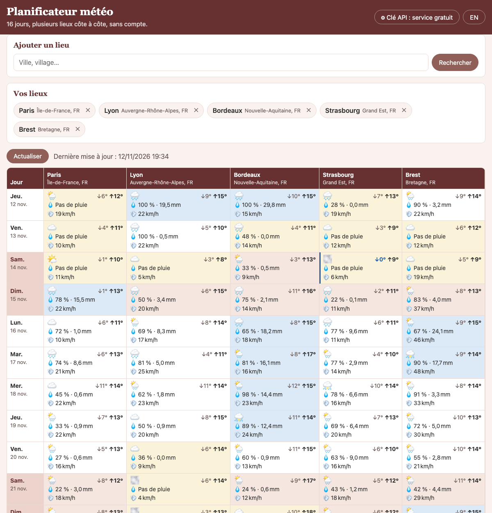

# Planificateur météo — weather planner

Compare the 16-day weather forecast for several places side by side, in one table: rain, wind and temperatures, day by day, with weekends highlighted. A static web page that runs in your browser: no account, no cookies, no server of its own.

**Try it:** https://marinailsapps.github.io/meteo/

## Features

- 16-day forecast, one row per day, one column per place. Weekends are highlighted.
- As many places as you like. Search by name anywhere in the world, add from the results, remove with ✕. The list is saved in your browser.
- For each day: weather icon, rain probability and amount (mm), maximum wind (km/h), minimum and maximum temperature (°C).
- Visual cues for frost (min ≤ 0 °C), heat (max ≥ 28 °C), heavy rain (≥ 10 mm) and dry days (0 mm).
- **Refresh** button and the time of the last update. The forecast is kept in your browser and refreshed automatically when it is more than an hour old.
- French and English interface. The language follows your browser (French by default) and can be switched with the button in the corner.
- Optional Open-Meteo API key for professional use (see below).
- Light and dark themes, following your system. Works on phones: the table scrolls sideways and the day column stays in place.

## Use it yourself

1. **Download and open.** Download `meteo-1.0.0.zip` from the [latest release](https://github.com/marinailsapps/meteo/releases/latest), unzip it and open `index.html` in a recent browser (Firefox, Chrome, Edge or Safari). An Internet connection is needed to load forecasts.
2. **Put it on your own site.** Copy `index.html`, `app.js`, `app.css`, `i18n.js` and `favicon.svg` to any static web host. No PHP, no database, no server-side code.
3. **Fork and publish with GitHub Pages.** Fork this repository, then in *Settings → Pages* choose *Deploy from a branch*, branch `main`, folder `/ (root)`.

If your browser blocks storage for files opened from disk, serve the folder instead, for example with `python3 -m http.server` and open http://localhost:8000/.

## Your own API key

Forecasts come from [Open-Meteo](https://open-meteo.com/). Without a key the app uses Open-Meteo's free service, which is for **non-commercial use only** and limited in the number of requests. For professional use, take out a subscription on [open-meteo.com/en/pricing](https://open-meteo.com/en/pricing) and enter the key with the **⚙ API key** button.

- **Test the key** makes one small request and tells you whether the key is accepted.
- **Save** stores the key in your browser (`localStorage`). Tick *Don't remember it* to keep it for the current tab only (`sessionStorage`).
- **Clear** removes it; the app goes back to the free service.
- With a key, requests go to `customer-api.open-meteo.com` and `customer-geocoding-api.open-meteo.com` with the `apikey` parameter. The key is sent to Open-Meteo only, never to anyone else, and never appears in the page address.

Error messages: **Limit reached** means too many requests (try later, or use your own key); **Key refused** means Open-Meteo did not accept the key (check it in your Open-Meteo account, or clear it).

## Privacy

No account, no cookies, no analytics, no third-party scripts or fonts. Your places, language choice, cached forecast and optional key are stored only in your browser. To show forecasts, your browser sends the names you search for and the coordinates of your places directly to Open-Meteo. A Content Security Policy in `index.html` only allows connections to Open-Meteo. The demo is hosted on GitHub Pages.

## Data and attribution

- Weather data by [Open-Meteo.com](https://open-meteo.com/), licensed under [CC BY 4.0](https://creativecommons.org/licenses/by/4.0/).
- Place search: [GeoNames](https://www.geonames.org/), licensed under [CC BY 4.0](https://creativecommons.org/licenses/by/4.0/).

Both credits are shown next to the table. Keep them if you publish your own copy.

## Limitations

Forecasts are weather-model estimates and become less reliable beyond about a week. Do not use them for safety decisions. Open-Meteo provides at most 16 days.

## Contact

apps@marinails.site · https://apps.marinails.site/meteo

## License

[MIT](LICENSE) © 2026 Maryna SYOMKO, entrepreneur individuel. Provided free of charge and as is, without support.

---

## En français

**Planificateur météo** : comparez dans un seul tableau les prévisions à 16 jours de plusieurs lieux côte à côte (pluie, vent, températures minimale et maximale), jour par jour, avec les week-ends mis en évidence et des repères pour le gel, la forte chaleur, la forte pluie et le temps sec. Aucun compte, aucun cookie : vos lieux restent dans votre navigateur.

- Essayer en ligne : https://marinailsapps.github.io/meteo/
- L'utiliser chez soi : téléchargez l'archive depuis la [dernière version](https://github.com/marinailsapps/meteo/releases/latest), décompressez-la et ouvrez `index.html`, ou copiez les fichiers sur n'importe quel hébergement statique.
- Sans clé, l'application utilise le service gratuit d'Open-Meteo, réservé à un usage non commercial. Pour un usage professionnel, saisissez votre propre clé Open-Meteo (bouton ⚙ Clé API) : elle reste dans votre navigateur et n'est envoyée qu'à Open-Meteo.
- Données météo : Open-Meteo.com (CC BY 4.0). Recherche de lieux : GeoNames (CC BY 4.0).
- Présentation et guide : https://apps.marinails.site/meteo
- Licence MIT.
